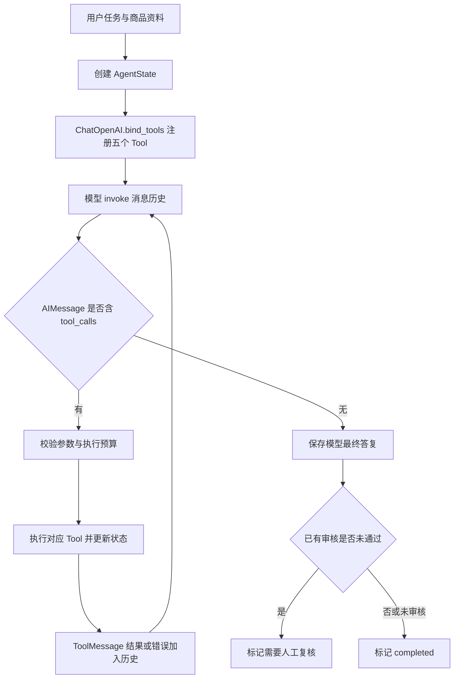

# AI 电商营销自动化工作流

基于 LLM、RAG、Agent 和 Tool Calling 的个人 Demo，将商品分析、知识检索、营销策略生成、内容创作与内容审核整合为可追踪的自动化工作流。

## 项目背景与目标

电商营销需要反复整理商品资料、查找知识、制定方案和审核内容，容易产生信息分散和流程重复。本项目尝试由 Agent 协调这些步骤，帮助形成营销初稿。项目用于技术学习和展示，没有真实企业商业收益、效率提升或转化率测量结论。

## 核心功能

| 能力 | 当前实现 |
| --- | --- |
| 商品理解 | 复用 ProductAnalysis，分析已确认卖点、人群、场景、需求和消费者价值 |
| RAG 检索 | DashScope Embedding + Chroma 相似度检索，并在相关候选中兼顾类别多样性 |
| 营销策略 | Pydantic 校验 11 个字段：定位、卖点、人群、场景、需求、价值、方向、渠道、内容、执行建议、风险控制 |
| 小红书内容 | 生成标题、正文、标签和行动引导；当前仅支持小红书 |
| 内容审核 | 基于关键词和结构规则检查未确认属性、风险表达及任务匹配 |
| 自动修正 | 审核失败后由模型决定继续生成、检索或结束；Python 限制最多 2 次修正 |
| 人工兜底 | 已有审核结果未通过时，最终状态为 needs_human_review；没有真实审批/发布系统 |
| Streamlit | 用户填写任务和商品信息，展示实际状态、Tool 事件、检索、策略、内容和审核 |

商品资料是运行时输入，不会由商品分析工具写入知识库。RAG 方法和历史案例是营销参考，不应被当成当前商品属性的证据。

## Agent 执行流程



真正的循环在 `app/agent/ecommerce_agent.py` 的 `EcommerceAgent.run()`：绑定工具后调用模型，解析模型返回的 `AIMessage.tool_calls`，执行 Tool，把对应 `ToolMessage` 加入同一消息历史，再次调用模型。

不是固定 Python 顺序调用五个 Tool。任务分类主要用于日志与评估，模型选择需要的工具；Python 仍实施前置约束，例如策略生成需要已完成商品分析和检索。推广任务通常使用五类能力，卖点问答或已有文案审核可以使用更少工具。

审核也是 Tool，可将修正建议送回模型。再次内容生成时读取这些建议，并计入修正次数。默认最多 12 次 Tool 调用、2 次内容修正；`iteration_count` 是修正次数，不是 LLM 决策轮数。

## 技术栈与架构

Python、LangChain Core / LangChain OpenAI、百炼 OpenAI-compatible Chat API / Qwen、DashScope Embedding、Chroma、Pydantic、Streamlit、python-dotenv。

| 层 | 文件与职责 |
| --- | --- |
| 交互 | streamlit_app.py 调用 run_agent，按实际返回字段展示结果 |
| 编排 | ecommerce_agent.py 执行模型决策循环；agent_state.py 保存状态与事件 |
| 工具 | agent_tools.py 定义五个 LangChain @tool 及输入 schema |
| 模型 | llm_factory.py 创建 ChatOpenAI；embedding_factory.py 调用 DashScope Embedding |
| 知识 | knowledge_loader.py 加载/切分 TXT；vector_store.py 检索；rag_context.py 组装参考上下文 |
| 评估 | evaluation_metrics.py 定义规则指标；agent_v2_demo.py 组织单案例报告 |

五个真实注册的业务 Tool 为 `analyze_product`、`knowledge_retrieval_tool`、`marketing_strategy_tool`、`content_generation_tool`、`content_review_tool`，均位于 `app/agent/agent_tools.py`。输入 schema 包含 `decision_reason`。

商品分析、策略和内容生成工具内部也会请求 LLM；检索工具会请求 Embedding API。审核工具本身使用确定性规则，不是另一位 LLM 审核 Agent。

## 项目目录结构

```text
app/
├── streamlit_app.py
├── agent/
│   ├── ecommerce_agent.py
│   ├── agent_state.py
│   └── agent_tools.py
├── product_analyzer.py
├── marketing_strategy_generator.py
├── marketing_strategy_workflow.py   # 保留的传统流程，不是页面 Agent 编排入口
├── vector_store.py
├── knowledge_loader.py
├── rag_context.py
├── evaluation_metrics.py
├── llm_factory.py
├── embedding_factory.py
└── runtime_config.py
knowledge_base/                      # brand / marketing_rules / marketing_cases / platform_rules
scripts/vector_store_builder.py      # 构建脚本
vector_store/                        # 本地 Chroma 数据
experiments/
├── agent_v2_demo.py
├── test_bailian_tool_calling.py
├── test_native_bailian_tool_calling.py
└── ...                              # RAG 对比、数据集与人工评估脚本
tests/
├── agent_v2_test.py
├── full_workflow_test.py
├── marketing_strategy_test.py
├── retriever_test.py
└── risk_control_test.py
requirements.txt
pyproject.toml
.env.example
```

目录按当前磁盘文件整理。已删除模块不作为当前架构组成部分；本地实验脚本和输出是否已提交到 Git，应另行核对。

## 环境配置

以下命令在项目根目录执行，使用 Python 3.12 或更高版本（依据 `pyproject.toml`）。

```powershell
python -m venv .venv
.\.venv\Scripts\Activate.ps1
python -m pip install -r requirements.txt
Copy-Item .env.example .env
```

已有 `.env` 时不要覆盖。编辑本地配置：

```dotenv
DASHSCOPE_API_KEY=your_api_key_here
DASHSCOPE_BASE_URL=https://dashscope.aliyuncs.com/compatible-mode/v1
DASHSCOPE_MODEL=your_tool_calling_capable_qwen_model
DASHSCOPE_EMBEDDING_MODEL=your_embedding_model
```

聊天模型由环境变量选择，主业务代码没有固定某个 Qwen 型号。配置应与账号权限、区域和服务端支持匹配；以上 Key 和模型值均为占位示例。

RAG 使用固定目录 `vector_store/marketing_strategy_kb` 和 collection `marketing_strategy_kb`。若没有可用的本地库，先检查构建脚本，再手动运行：

```powershell
python -m scripts.vector_store_builder
```

构建会调用 Embedding API 并写入本地数据。已有库不应为启动页面而盲目重建；查询模型必须与建库向量模型兼容。

依赖限制：`requirements.txt` 未锁定版本；`pyproject.toml` 的 dependencies 为空，不能仅靠安装该项目元数据获取运行依赖。原生诊断脚本还直接使用 OpenAI SDK（由 langchain-openai 的依赖带入）。当前没有经过本轮验证的干净环境安装结果。不要提交 `.env` 或真实 Key。

## 运行方法

### Streamlit 页面

```powershell
python -m streamlit run app/streamlit_app.py
```

运营任务由用户填写，不预置为固定任务。页面必填任务、商品名称、商品类型和已确认卖点；还支持品牌、使用场景、详细资料和待审核文案。

页面展示实际成功 Tool 轨迹、事件与错误、调用次数、修正次数、知识来源及摘要、完整策略和内容。工作流展示是界面摘要，不代表后端固定执行顺序。

### Agent V2 单案例 Demo

```powershell
python experiments/agent_v2_demo.py
```

入口 `run_demo()` 调用 `run_agent()`，运行 AAA 示例并生成六类规则评估：Tool 选择、检索质量、事实一致性、合规、任务完成度、修正效率。报告写入并覆盖 `experiments/agent_v2_evaluation_report.json`。

这会请求真实 LLM / Embedding 并读取 Chroma，可能产生费用。它只运行单案例，不等同于完成批量实验。

### 离线协议测试

```powershell
python tests/agent_v2_test.py
```

`ScriptedModel` 预先构造 `AIMessage.tool_calls`，业务调用被 mock。覆盖五类 Tool 调度、bind_tools、ToolMessage、多轮历史、调用预算、状态更新、两次修正上限、事实边界和 decision_reason schema。

这是 Offline Protocol Test，不能证明真实百炼模型自主生成 tool_calls。之前该离线入口已通过；本轮文档核查未重新运行。

### 在线检查入口

```powershell
python experiments/test_bailian_tool_calling.py
python experiments/test_native_bailian_tool_calling.py
python tests/full_workflow_test.py
python tests/marketing_strategy_test.py
python tests/retriever_test.py
python tests/risk_control_test.py
```

这些入口并非统一的离线测试套件。诊断脚本分别验证 LangChain 和 OpenAI SDK 协议；其他脚本涉及传统流程或检索，可能请求 LLM / Embedding。原生 SDK 诊断固定使用 qwen3-max，不自动加载 .env，需要调用进程已有 DASHSCOPE_API_KEY 环境变量。运行前阅读代码、确认费用和数据影响，不建议直接执行整个 tests 目录。

## 示例任务

AAA 模拟品牌的 Demo 输入：

- 商品名称：户外三合一冲锋衣
- 商品类型：户外服装
- 已确认卖点：三合一设计、防风、防水
- 使用场景：登山、徒步、户外运动
- 任务：帮我为这款冲锋衣制定一套小红书推广方案

未提供面料、防水等级、温度范围或其他性能参数，不能将其编造为商品事实。

## 实际实现与限制

**实现与验证边界**

真实模型 Tool Calling 循环、五个 Tool、ToolMessage 回传、状态更新、RAG、结构化生成和规则审核均有实际代码。此前真实运行曾产生模型调用、检索与策略结果，但不代表完整 AAA 任务已经全部通过；本轮不请求在线 API，不宣称完成新的在线验收。

**已知限制**

- 此前真实内容生成遇到 tags 返回字符串而非列表，触发结构校验失败；本轮检查的代码仍直接解析 JSON 并进行 Pydantic 校验，没有通用输出修复机制。
- 模型无 tool_calls 就结束；没有强制检查推广任务是否已生成全部结果或执行审核。completed 不等于业务验收通过；若没有审核结果，也可能标记 completed。
- 审核是有限关键词和结构规则，不能完整理解语义、核验真实商品或保证符合最新平台规定。检索规则类别会被记录，但不是完整自动规则执行。
- 人工兜底是状态标记，不是审批系统。普通 Tool 错误会反馈给模型，未必都转成人工审核状态。
- retrieval_quality 已兼容 dict / Document；Demo 把事件中的 top_k 传给评估。但若模型省略 top_k（Tool schema 有默认值）、未检索或调用失败，Demo 的 top_k 提取仍可能报错或与最终成功检索不一致。
- evaluate_rag_effectiveness 仍按 Document 属性读取，不是所有评估函数都兼容字典。规则指标不等同于语义检索准确率、营销效果或商业质量。
- 迭代效率评估关注修正次数；LLM 多轮决策记录在 events 中。Streamlit 仅在返回结果含 evaluation 时展示报告，当前 run_agent 不自动附带 Demo 的评估报告。
- 依赖版本未锁定，批量实验未在本轮重跑。历史报告不是当前配置的全项通过证明。
- 尚无经验证的生产部署、真实用户规模、商业收益或自动发布能力。

## 后续改进方向

- 补充结构化输出异常、提前结束和外部服务失败的回归测试。
- 统一检索结果格式与成功检索参数记录，提高评估兼容性。
- 增加检索语义质量和审核漏检/误检评估。
- 完善日志、超时、重试与异常状态表达。
- 建立可复现的依赖环境和在线验收流程。

最终策略与文案应由业务人员结合真实商品资料和最新平台规范复核。项目不宣称“企业级”“生产级”能力。
